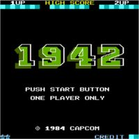
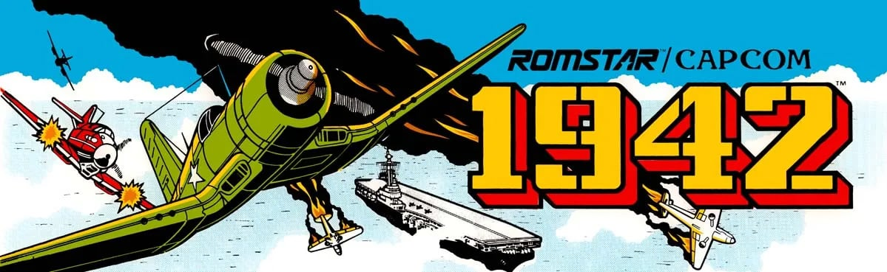
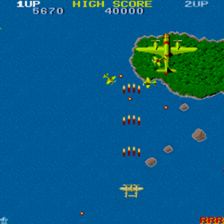
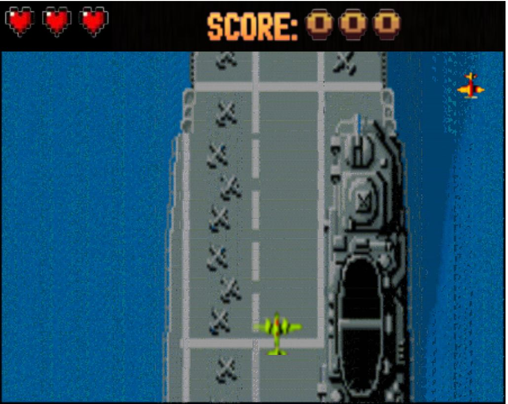
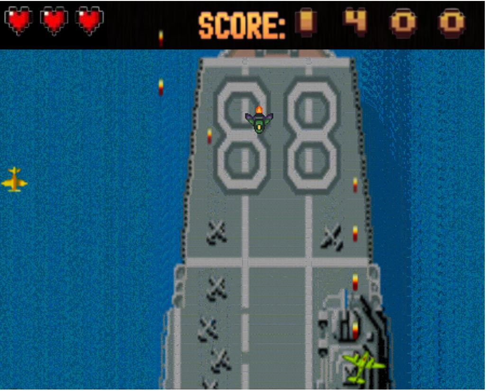
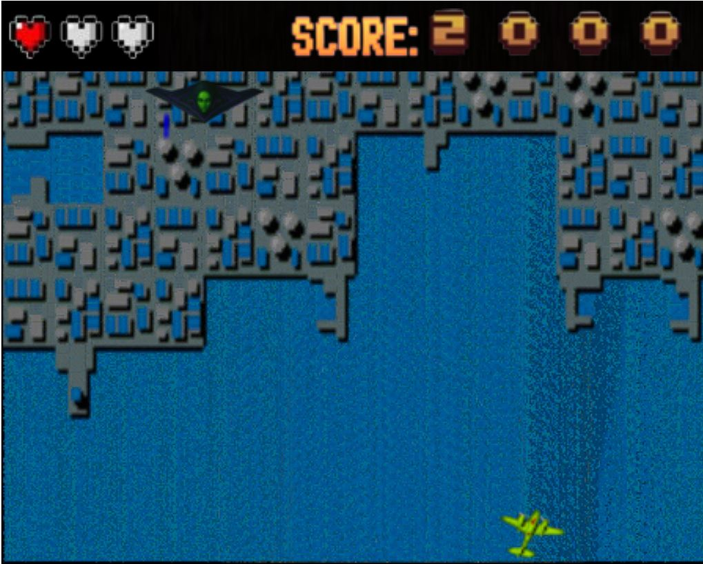
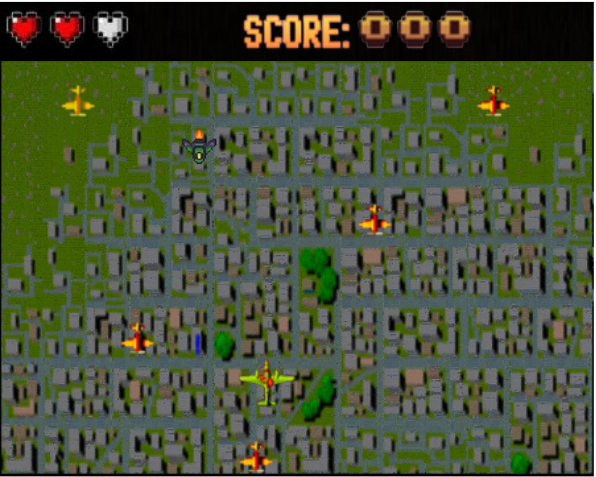
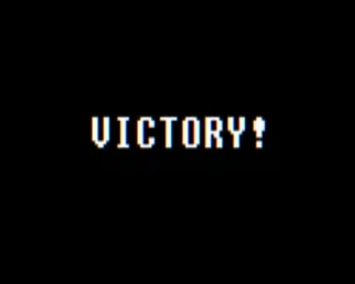
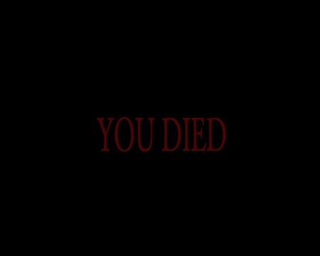

<div align="center">

# ✈️ Arcade 1942 — Wollok Game

### *Recreación del legendario shoot 'em up de Capcom con Arquitectura y Diseño Puro Orientado a Objetos*

*Universidad Tecnológica Nacional (UTN-FRBA) — Paradigmas de Programación (2025)*

<br>

<p align="center">
  
  &nbsp;
  <b>Engine: Wollok Game</b>
  &nbsp;&nbsp;•&nbsp;&nbsp;
  <b>Paradigma: Object-Oriented Programming (POO)</b>
</p>

[](https://www.wollok.org/)
[](#)
[](#)
[](#)
[](#)

<br><br>



</div>

---

## 📑 Índice de Contenidos

* [📌 Resumen del Proyecto](#-resumen-del-proyecto)
* [🕹️ El Clásico vs Recreación Wollok](#-el-clásico-vs-recreación-en-wollok)
* [🎮 Mecánicas de Juego y Controles](#-mecánicas-de-juego-y-controles)
  * [Objetivo del Jugador](#objetivo-del-jugador)
  * [Tabla de Controles](#tabla-de-controles)
  * [Sistema de Daño, Vidas e Inmunidad](#sistema-de-daño-vidas-e-inmunidad)
* [🧠 Arquitectura de Software y Patrones POO](#-arquitectura-de-software-y-patrones-poo)
  * [1. Double Dispatch (Colisiones sin `if/instanceof`)](#1-colisiones-limpias-mediante-double-dispatch)
  * [2. Jerarquía Polimórfica de Enemigos y Overrides](#2-jerarquía-polimórfica-de-enemigos-y-overrides)
  * [3. State Pattern y Controladores de Pantallas](#3-state-pattern-y-controladores-de-flujo)
  * [4. Game Loop, Temporizadores y Spawners Reactivos](#4-game-loop-temporizadores-y-spawners-reactivos)
* [📐 Diagramas Estáticos (UML)](#-diagramas-estáticos-uml)
* [🧪 Pruebas Unitarias Automatizadas (30 Tests)](#-pruebas-unitarias-automatizadas)
* [📸 Galería Visual del Juego](#-galería-visual-del-juego)
* [🚀 Cómo Ejecutar el Proyecto](#-cómo-ejecutar-el-proyecto)
* [📖 Informe Detallado Entrega por Entrega](docs/EXPLICACION_COMPLETA.md)
* [👥 Equipo de Desarrollo](#-equipo-de-desarrollo)

---

## 📌 Resumen del Proyecto

> [!TIP]
> **¿Buscás el informe académico original entrega por entrega?**  
> Podés consultar el desglose exhaustivo de clases, explicaciones teóricas y código comentado en el documento:  
> 📖 **[Informe Técnico y Explicación Detallada (docs/EXPLICACION_COMPLETA.md)](docs/EXPLICACION_COMPLETA.md)**.


Este proyecto consiste en el desarrollo integral del clásico shoot 'em up **1942** (Capcom, 1984), programado desde cero sobre el motor **Wollok Game** para la materia **Paradigmas de Programación** en la **UTN-FRBA**.

El desafío técnico no fue solo replicar la estética y jugabilidad retro, sino diseñar un **modelo de objetos robusto, desacoplado y extensible**, demostrando la aplicación práctica de conceptos clave de la industria:
* **Double Dispatch** para evitar estructuras condicionales frágiles al resolver colisiones e interacciones.
* **Polimorfismo puro y herencia con redefinición (`override`)** para gestionar oleadas de combatientes con atributos y comportamientos diferenciados.
* **Separación de responsabilidades** entre la lógica del jugador, los administradores de nivel, el motor de pantallas y el HUD visual.
* **Diseño testeable con 30 casos de prueba unitarios** cubriendo la integridad del modelo.

---

## 🕹️ El Clásico vs Recreación en Wollok

<div align="center">
  <table>
    <tr>
      <th align="center" width="50%">Arcade Original (Capcom, 1984)</th>
      <th align="center" width="50%">Recreación en Wollok Game (UTN 2025)</th>
    </tr>
    <tr>
      <td align="center">
        
      </td>
      <td align="center">
        
      </td>
    </tr>
  </table>
</div>

---

## 🎮 Mecánicas de Juego y Controles

### Objetivo del Jugador
El piloto debe sobrevolar el espacio aéreo del Pacífico, interceptar formaciones enemigas, esquivar disparos hostiles, sumar el mayor puntaje posible y sobrevivir hasta derribar al **Jefe Final**.

### Tabla de Controles

| Tecla / Acción | Tipo | Descripción |
| :---: | :---: | :--- |
| **`Enter`** | Menú | Iniciar partida desde la pantalla de bienvenida |
| **`⬅️ ⬆️ ⬇️ ➡️`** | Movimiento | Navegar la nave en 4 direcciones respetando los límites del mapa |
| **`X`** | Combate | Disparar proyectil frontal hacia las líneas enemigas |

### Sistema de Daño, Vidas e Inmunidad
* **Vidas iniciales:** El jugador cuenta con **3 vidas** representadas en tiempo real en el HUD superior (`corazonesX.png`).
* **Mecánica de Inmunidad:** Tras recibir impacto de una bala o colisionar con un caza enemigo, el jugador entra en estado inmune durante **3.5 segundos**, activando una rutina de parpadeo visual (`jugadorHerido.png` / `jugadorTransparente.png`) para permitir la recolocación estratégica sin recibir daño consecutivo inmediato.
* **Game Over:** Si las vidas llegan a 0 se reproduce el sonido de derrota y se transiciona a la pantalla de Game Over; si se neutraliza al Jefe, se accede a la pantalla de Victoria.

---

## 🧠 Arquitectura de Software y Patrones POO

### 1. Colisiones Limpias mediante Double Dispatch
En lugar de delegar la resolución de colisiones a condicionales rígidos con chequeos de tipo (`if (otro is Enemigo)`), se implementó el patrón **Double Dispatch**. El motor notifica la colisión y la entidad receptora delega en el objeto entrante:

```wollok
// En Jugador, Enemigo y Proyectiles
method interactuarCon(otro) {
    otro.interactuarConJugador(self)
}

// Implementación polimórfica en clases de soporte:
method interactuarConJugador(jugador) {
    jugador.recibirDanio(self.danio())
}

method interactuarConProyectil(proyectil) {
    self.recibirDanio(proyectil.danio())
    proyectil.remover()
}

// Colisiones neutras (ej: dos enemigos que se tocan o bala con bala) no ejecutan acción:
method interactuarConEnemigo(enemigo) { }
```

### 2. Jerarquía Polimórfica de Enemigos y Overrides
Todas las amenazas derivan de la clase base abstracta `Enemigo`, garantizando una interfaz uniforme de movimiento, recepción de daño y remoción:

* **`Enemigo` (Caza Ligero):** 1 vida, velocidad base, trayectoria vertical estándar.
* **`EnemigoRapido`:** Alta velocidad, cadencia de aparición veloz, ideal para obligar al jugador a moverse.
* **`EnemigoPesado`:** 2 vidas, blindaje reforzado y capacidad de contraataque activo disparando sus propios proyectiles (`spawnDisparo`).
* **`Jefe Final`:** 10 vidas, movimiento lateral automatizado en la franja superior y ráfagas de ataque coordinadas.

### 3. State Pattern y Controladores de Flujo
* **`nivelManager`**: Mantiene la pila de niveles activos, ejecuta la limpieza de objetos visuales (`game.clear()`) y orquesta el avance de misiones.
* **`pantallas`**: Modela el ciclo visual de la aplicación (Inicio, Pantalla de Controles, Carga con GIF animado, Derrota y Victoria), coordinando transiciones mediante eventos asíncronos programados (`game.schedule()`).
* **`hud`**: Módulo desacoplado encargado del renderizado reactivo de la barra de salud y el contador de puntos numérico.

### 4. Game Loop, Temporizadores y Spawners Reactivos
El ciclo de juego en [`src/niveles.wlk`](src/niveles.wlk) utiliza eventos periódicos sincronizados con el reloj del motor:
* `onTick(2000, "spawEnemigos", ...)` para oleadas constantes.
* `onTick(8000, "spawnEnemigoPesado", ...)` para cazas acorazados.
* `schedule(40000, ...)` para pausar spawners periféricos e introducir la batalla climática contra el Jefe.

---

## 📐 Diagramas Estáticos (UML)

<div align="center">
  <p><b>Diagrama de Clases del Dominio Completo</b></p>
  
</div>

---

## 🧪 Pruebas Unitarias Automatizadas

La suite en [`src/Test.wtest`](src/Test.wtest) contiene **30 casos de prueba automatizados** que certifican el correcto modelado de objetos:

* **Módulo Jugador (Tests 1 al 12):** Validación de puntos de vida iniciales (3), desplazamiento espacial, alteración de sprites, decremento de vidas por daño recibido, umbrales de muerte, acumulación incremental de puntuación y activación/desactivación del escudo de inmunidad.
* **Módulo Enemigos (Tests 13 al 25):** Vida y daño diferencial entre unidades estándar y acorazadas, neutralización con proyectiles, colisión dañina con el jugador e inocuidad en colisiones entre naves aliadas.
* **Módulo Jefe Final (Tests 26 al 30):** Puntos de resistencia (10 vidas), cálculo de daño compuesto y algoritmos de reubicación en la grilla.

---

## 📸 Galería Visual del Juego

<div align="center">
  <table>
    <tr>
      <td align="center" width="50%">
        <b>Despliegue y Combate en Oleadas</b><br>
        
      </td>
      <td align="center" width="50%">
        <b>Disparo de Proyectiles Frontales</b><br>
        
      </td>
    </tr>
    <tr>
      <td align="center" width="50%">
        <b>Enfrentamiento contra el Jefe Final</b><br>
        
      </td>
      <td align="center" width="50%">
        <b>Efecto de Daño e Inmunidad Activa</b><br>
        
      </td>
    </tr>
    <tr>
      <td align="center" width="50%">
        <b>Pantalla de Victoria</b><br>
        
      </td>
      <td align="center" width="50%">
        <b>Pantalla de Derrota (Game Over)</b><br>
        
      </td>
    </tr>
  </table>
</div>

---

## 🚀 Cómo Ejecutar el Proyecto

1. Clonar el repositorio en tu máquina:
   ```bash
   git clone git@github.com:MaximoHidalgo/arcade-1942-wollok.git
   ```
2. Abrir la carpeta en **Visual Studio Code** teniendo instalada la extensión oficial de **Wollok**.
3. Navegar a [`src/main.wpgm`](src/main.wpgm) y presionar el botón de **Play (Ejecutar programa Wollok)** o `F5`.
4. Para ejecutar la suite completa de tests, abrir [`src/Test.wtest`](src/Test.wtest) y presionar **Run all tests**.

---

## 👥 Equipo de Desarrollo

Proyecto desarrollado para la materia **Paradigmas de Programación (2025)** en la **Universidad Tecnológica Nacional (UTN-FRBA)**:
* **Máximo Juan Manuel Hidalgo** ([@MaximoHidalgo](https://github.com/MaximoHidalgo))
* Jeremías Boutet ([@Jereboutet](https://github.com/Jereboutet))
* Darío Regojo ([@dregojo](https://github.com/dregojo))
* Elian Spallina Alcoba ([@elianspal](https://github.com/elianspal))
* Matías Miguel Del Rosso Smolar ([@MatiasDelRosso](https://github.com/MatiasDelRosso))
