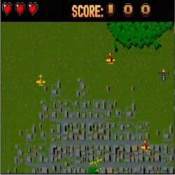
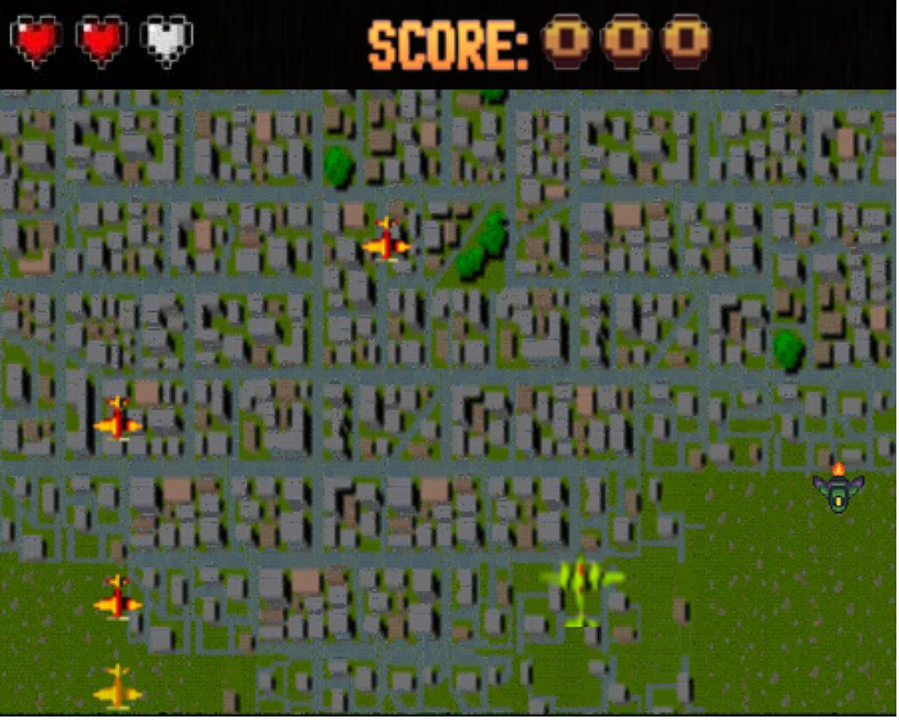

[⬅️ Volver al README Principal](../README.md)

---

# 📖 Informe Técnico y Explicación Detallada: Arcade 1942 en Wollok

> [!NOTE]
> Este documento preserva y recopila la **explicación técnica original, entrega por entrega**, del desarrollo de Arcade 1942 para la materia *Paradigmas de Programación (UTN-FRBA)*, incluyendo el desglose metodológico, código comentado y diagramas de arquitectura.

---

# 🧠 Grupo El ultimo paradigma - Arcade 1942 hecho en Wollok


## Tabla de Contenidos - Índice
- [🧠 Grupo El ultimo paradigma - Arcade 1942 hecho en Wollok](#-grupo-el-ultimo-paradigma---arcade-1942-hecho-en-wollok)
  - [Tabla de Contenidos - Índice](#tabla-de-contenidos---índice)
  - [📄 Consigna: Pautas - TP Juegos Objetos 2025](#-consigna-pautas---tp-juegos-objetos-2025)
  - [📚 Paradigmas de programación - Año 2025](#-paradimas-de-programación---año-2025)
  - [👥 Integrantes del Grupo](#-integrantes-del-grupo)
- [🎮 ¿Qué juego es el 1942?](#-qué-juego-es-el-1942)
  - [¿Que objetivo teniamos con este proyecto en Wollok?](#que-objetivo-teniamos-con-este-proyecto-en-wollok)
- [🎮 Sobre el juego](#-sobre-el-juego)
  - [Cual es el objetivo del jugador](#cual-es-el-objetivo-del-jugador)
  - [Controles e instrucciones:](#controles-e-instrucciones)
- [Entregas ordenadas por consigna](#entregas-ordenadas-por-consigna)
  - [Entrega 1 - Ideas y Prototipo Inicial](#entrega-1---ideas-y-prototipo-inicial)
    - [Objetivo](#objetivo)
    - [Metas del juego](#metas-del-juego)
  - [Entrega 2 - Lógica principal funcionando](#entrega-2---lógica-principal-funcionando)
  - [Entrega 3](#entrega-3)
  - [Explicaciones Teóricas](#explicaciones-teóricas)
  - [Presentacion del Juego:](#presentacion-del-juego)
    - [Explicación de como es el jugador:](#explicación-de-como-es-el-jugador)
    - [Explicación del controlador de nivel:](#explicación-del-controlador-de-nivel)
    - [Explicación del controlador de pantallas:](#explicación-del-controlador-de-pantallas)
  - [Polimorfismo y herencia:](#polimorfismo-y-herencia)
- [📸 Imagenes del juego](#-imagenes-del-juego)
  - [🚀 Evolución y Extensión: Implementación del Nivel 2 y Gestión Avanzada de Niveles](#-evolución-y-extensión-implementación-del-nivel-2-y-gestión-avanzada-de-niveles)
    - [1. Arquitectura de Múltiples Niveles (`nivelManager`)](#1-arquitectura-de-múltiples-niveles-nivelmanager)
    - [2. Nivel 2: Asedio Aéreo Avanzado](#2-nivel-2-asedio-aéreo-avanzado)
    - [3. Nuevas Mecánicas de Combate y Proyectiles](#3-nuevas-mecánicas-de-combate-y-proyectiles)
    - [4. Jefe del Nivel 2 (`jefeNivel2`): Mecánicas Reactivas](#4-jefe-del-nivel-2-jefenivel2-mecánicas-reactivas)
    - [5. Optimizaciones Críticas del Motor de Juego y Solución de Bugs](#5-optimizaciones-críticas-del-motor-de-juego-y-solución-de-bugs)
    - [6. Cobertura de la Suite de Pruebas Automatizadas (42 Tests)](#6-cobertura-de-la-suite-de-pruebas-automatizadas-42-tests)
- [Referencias](#referencias)

## 📄 Consigna: [Pautas - TP Juegos Objetos 2025](https://docs.google.com/document/d/12Gj_MrR9fLi926D66XO_tRvhrnWc4T2gjpfusKGZy0I/edit?tab=t.0#heading=h.wnm2lu4cls8j)

## 📚 Paradigmas de programación - Año 2025  

Paradigma Orientado a Objetos - TP Integrador Grupal Juego con Wollok Game

## 👥 Integrantes del Grupo

| Nombre completo                | GitHub                                      |
|-------------------------------|---------------------------------------------|
| Jeremías Boutet               | [Jereboutet](https://github.com/Jereboutet) |
| Máximo Juan Manuel Hidalgo    | [MaximoHidalgo](https://github.com/MaximoHidalgo) |
| Dario Regojo                  | [dregojo](https://github.com/dregojo)     |
| Elian Spallina Alcoba         | [elianspal](https://github.com/elianspal) |
| Matías Miguel Del Rosso Smolar| [MatiasDelRosso](https://github.com/MatiasDelRosso) |

---


# 🎮 ¿Qué juego es el 1942?

- 1942 es un videojuego de shoot 'em up que fue desarrollado por Capcom y lanzado para máquinas recreativas en 1984. Fue el primer juego de la serie 19XX. Fue seguido por 1943: The Battle of Midway.
- El juego se lanzo en modo un solo jugador, en idioma ingles y en las consolas 	Arcade, NES, MSX, Game Boy Color, etc.


## ¿Que objetivo teniamos con este proyecto en Wollok?
El objetivo de este proyecto fue recrear la esencia y la gloria de un clásico videojuego, desarrollándolo íntegramente en Wollok y aplicando los conceptos aprendidos durante la cursada del Paradigma Orientado a Objetos.

A lo largo del desarrollo, se buscó reproducir las mecánicas características del juego original, manteniendo su espíritu y estilo, pero adaptándolo a las posibilidades que ofrece WollokGame y a las capacidades y limitaciones propias del equipo.

Este prototipo demuestra las capacidades del entorno WollokGame como herramienta para el diseño de videojuegos orientados a objetos, sirviendo además como una base sólida para incorporar nuevas funcionalidades y expandir futuras ideas.





# 🎮 Sobre el juego

## Cual es el objetivo del jugador
El objetivo del jugador dentro del juego es sobrevivir y completar la misión, en este caso es conseguir la mayor cantidad de puntos y derrotar al jefe.
Durante la partida, el jugador podrá:

   - Moverse libremente por el mapa evitando los ataques enemigos.
   - Derribar aviones enemigos mientras esquiva proyectiles.
   - Sumar la mayor cantidad de puntos posibles.
   - Perder vidas y morir.
   - Superar oleadas de enemigos y enfrentarse a jefe final para terminar el juego y tener la victoria.

## Controles e instrucciones:
1. Una vez que inicia el juego tenes que ingresar apretando Enter.
2. Desde ahi el jugador puede interactuar moviendose con las flechas del teclado en las 4 direcciones: ⬆️⬇️⬅️➡️ .
3. Para disparar utiliza la tecla "x". 
4. El jugador tiene que evitar perder sus 3 vidas y completar el juego derrotando al jefe.
5. Si derrota enemigos suma puntos.


# Entregas ordenadas por consigna

## Entrega 1 - Ideas y Prototipo Inicial

### Objetivo
Presentar diferentes ideas de juegos y un primer prototipo sencillo que implemente las funcionalidades iniciales vistas en clase.

### Metas del juego
Este prototipo demuestra los primeros pasos del desarrollo y sirve como base para incorporar futuras ideas. Entre los objetivos se encuentra intentar incorporar otras mecanicas, jefes, mas armas y mejorar las interfaces para el jugador.

## Entrega 2 - Lógica principal funcionando

Diagrama Estático: 
[≪object≫;jugador|position; vidas; puntos; img |cambiarImagen(nuevaImagen);image();ataque();recibirDanio(danio); morir()]

[Proyectiles|position; danioProyectil; image|cambiarImagen(nuevaImagen);danioProyectil();spawnDisparo(posicion);remover();comprobarLimiteMapa();avanzar();poderAtaque(enemigo)]

[Enemigos|position; vida; image; danio|spawnEnemigo(position);movimiento()hacerDanio();remover();comprobarLimiteMapa();comprobarMorir();recibirDanioDelJugador]

// Relaciones
[jugador]<->[Enemigos]
[Proyectiles]->[Enemigos]
[jugador]-.->[Proyectiles]


## Entrega 3 

## Explicaciones Teóricas

Explicaciones Teóricas

En jugador.wlk después de definir el objeto jugador creamos una class Proyectiles para definir los atributos y comportamientos que tienen los proyectiles que lanza el jugador. Usando herencia creamos la class ProyectilEnemigo que hereda de la class Proyectiles. Luego la creación y movimientos de los proyectiles están definidos por un onTick en niveles.wlk.

En enemigos.wlk utilizamos una class Enemigo para definir a los enemigos del juego con sus atributos base y sus comportamientos esto para luego poder crear múltiples enemigos. Luego gracias a la herencia podemos crear subclases de enemigos que compartan atributos y comportamiento como también que haya comportamientos que cambien utilizando override como ejemplo a la subclase EnemigoPesado que hace un override a method comprobarLimiteMapa(), method avanzar() y a method spawnDisparo(). También gracias a la herencia, pero no este caso no siendo una subclase utilizamos la herencia para crear al objeto jefe. Luego los enemigos son creados y se mueven mediante un onTick que está definido en niveles.wlk.

En hud.wlk es donde especificamos como se va a crear el hud del juego y como este se va a ir actualizando en función de la vida del jugador y de la cantidad de puntos que este consiga eliminando enemigos. 

En niveles.wlk se utiliza el onTick para poder definir cómo y cada cuanto va a ser el spawn de enemigos, cada cuanto se mueven ellos y en el caso de ciertos enemigos como se mueven sus proyectiles. También se genera el puntaje del jugador que se va actualizando a medida que este elimine enemigos y las vidas que tiene el jugador.

*Diagrama Estático actualizado*:


## Presentacion del Juego:

### Explicación de como es el jugador:

Arrancamos creando al objeto jugador con sus vidas, puntos, imagen, su inmunidad y su posición inicial como atributos. Después tenemos el method interactuarConEnemigo() que hace que, si el jugador colisiona con un enemigo, el jugador reciba daño. Algo parecido ocurre con el method interactuarConProyectilRival() que hace lo mismo, pero agregando que al colisionar con el proyectil este se remueva. Cuando colisiona el proyectil o el enemigo se aplica el method recibirDanio() que le resta vida al jugador y actualiza la cantidad de vidas visibles en el hud, con la particularidad de que si la inmunidad esta activada esto se ignora y el jugador sigue con la misma vida. La inmunidad se activa después de que el jugador reciba daño y hace que por 3,5 segundos el jugador tenga inmunidad definido por un schedule. El method parpadear() hace que el jugador alterne entre visible y transparente mientras dura la inmunidad, mostrando la imagen de “jugador herido” y luego volviendo a la imagen base. Si el jugador se queda sin vidas se pasa al method morir que lo que hace es cambiar a la pantalla de derrota con su música de derrota. Para realizar un ataque tenemos el method ataque que por cada vez que se presiona la tecla "x" se crea un nuevo proyectil que está definido por la clase Proyectiles. Cuando el jugador logra eliminar enemigos el method sumarPuntos() incrementa la cantidad de puntos del jugador.


``` wollok
object jugador {
  var property position = game.at(5, 1)
  var property vidas = 3
  var property puntos = 0
  var property image = "jugadorBase.png"
  var property inmune = false
  
  method interactuarCon(otro) {
    otro.interactuarConJugador(self)
  }
  
  method interactuarConEnemigo(enemigo) {
    self.recibirDanio(enemigo.danio())
  }
  
  method interactuarConProyectilRival(proyectil) {
    self.recibirDanio(proyectil.danio())
    proyectil.remover()
  }
  
  method interactuarConProyectil(proyectil) {} // no hace nada
  
  method ataque() {
    const proyectil = new Proyectiles(position = self.position(), danio = 1)
    proyectil.spawnDisparo(self.position())
    nivel1.proyectiles().add(proyectil)
  }
  
  method recibirDanio(danio) {
    if (self.inmune()) return vidas// Si está inmune, ignora el golpe
    vidas = vidas - danio
    

    if (vidas == 2) {cantVida.image("corazones2.png") game.sound("impactoJugador.wav").play()} 
    if (vidas == 1) {cantVida.image("corazones1.png") game.sound("impactoJugador.wav").play()}
    if (vidas <= 0) {cantVida.image("corazones0.png")
      self.morir()
    }
    
    // Activar inmunidad temporal (3,5 segundos)
    self.inmune(true)
    self.parpadear(6)
    game.schedule(3500, {self.inmune(false)})
    
    return vidas
  }

  method morir() {
    game.sound("sonidoMuerte.wav").play()
    self.image("jugadorPierde.png")
    game.schedule(500,{pantallas.pantallaFinalizacion("pantalla-derrota.png","sonidoDerrota.wav")})
  }

  method parpadear(veces) {
    var visible = true
    game.onTick(200, "blinkJugador", {
      visible = !visible
      if (visible) self.image("jugadorHerido.png")
        else self.image("jugadorTransparente.png")
    })

    game.schedule(3500, {
      game.removeTickEvent("blinkJugador")
      self.image("jugadorBase.png")
    })
  }
  
  method sumarPuntos(cantidad) {
    puntos += cantidad
  }
}
```
### Explicación del controlador de nivel:

Se crea el objeto nivelManager que tiene una lista constante de niveles y otro atributo llamado actual que apunta al objeto pantallas. En el method iniciarSigNivel hace que si la lista niveles esta vacía el juego pasa a una pantalla de victoria utilizando el method pantallaFinalizacion(), sino agarra el primer nivel que está en la lista, lo inicia para luego removerlo de la lista y que no se repita. Con el method terminarNivel() se usa el method limpieza() que limpia los elementos del nivel actual y se pasa al method animaciónCargando() para mostrar la pantalla de carga antes del siguiente nivel. El method limpieza hace un game.clear() y detiene la música de fondo.

``` wollok
object nivelManager {
    const property niveles = [nivel1]
    var property actual = pantallas

    method iniciarSigNivel() {
        if (niveles.isEmpty()) {
            juego.estado(cargando)
            pantallas.pantallaFinalizacion("pantalla-victoria.png","sonidoVictoria.wav")
        }
        actual = niveles.first()
        actual.iniciar()
        niveles.remove(actual)
    }

    method terminarNivel(){
        self.limpieza()
        pantallas.animacionCargando()
    }

    method limpieza(){
        game.clear()
        musicaDeFondo.stop()
    }

}
```
### Explicación del controlador de pantallas:

El controlador de pantallas tiene al objeto pantallas que actúa como controlador visual y hereda de ObjetoPasivo, lo que significa que no interactúa activamente con otros objetos, sino que muestra imágenes y sonidos. El juego arranca con una imagen de inicio para que después de tocar "enter" se ejecute el method pantallaInicio() que cambia la imagen, agrega un sonido y luego de un schedule pase al method animacionCargando() donde se vuelve a cambiar la imagen por un gif de cargando y luego de otro schedule se hace el method limpiar() que remueve todos los visuales y pasa al method abandonarCargando() que lo que hace es que el nivelManager haga el method iniciarSigNivel(). El method pantallaFinalizacion() hace que el nivelManager haga el method limpieza() para que remueva los elementos del nivel anterior, ejecute sonido, remueva los visuales, pone imagen de victoria y luego de un schedule se realice un game.stop().

``` wollok
object pantallas inherits ObjetoPasivo {
    var property position = game.origin()
    var property image = "inicio.png"
     
    method pantallaInfoControles() {
        image = "Controles.png"
    }

    method pantallaDeInicio() {
        image = "Inicio2.png"
        game.sound("sonidoStart.wav").play()
        game.schedule(700,{self.animacionCargando()})
    }

    method animacionCargando() {
        juego.estado(cargando)
        self.image("cargando.gif")
        musicaDeFondo.play("audioCargando.wav")
        game.schedule(6800, {self.limpiar()})
    }

    method limpiar() {
        game.allVisuals().forEach({visual => game.removeVisual(visual)})
        self.abandonarCargando()
    }

    method abandonarCargando() {
        nivelManager.iniciarSigNivel()
        game.removeVisual(self)
    }

    method pantallaFinalizacion(imagen, musica) {
        nivelManager.limpieza()
        game.sound(musica).play()
        game.allVisuals().forEach({visual => game.removeVisual(visual)})
        image = imagen
        game.addVisual(self)
        game.schedule(2000,{game.stop()})
    }
```
## Polimorfismo y herencia:

El concepto del herencia se puede observar por ejemplo en los enemigosPesados y el objeto Jefe, los cuales heredan la clase Enemigo y por ende conservan sus métodos con algún posible override entre ellos o agregar variables/métodos propios. También los Proyectiles son heredados por proyectilEnemigo. Todo esto se puede observar en el Diagrama Estático presentado previamente.
Otro ejemplo fuera del diagrama es la clase llamada Nivel que es heredada luego por los objetos nivel1, nivel2 y nivel3, aunque para esta primera versión sólo tenemos detalles del nivel1. Pero en caso de seguir desarrollando el juego, el nivel2, nivel3 y futuros nuevos niveles usarían la misma estructura de Nivel.
```
class Nivel{
    var property enemigos = []
    var property proyectiles = []
    var property imagenFondo
    var property musicaFondo

    method iniciar() {
        mapa.visualizarCon(imagenFondo)
        musicaDeFondo.play(musicaFondo)
        game.addVisualCharacter(jugador)
        self.configurarControles()
        hud.dibujar()
        self.iniciarSpawners()
        self.configurarColisiones()
    }

    method configurarControles() {
        keyboard.left().onPressDo({ jugador.image("jugadorIzqu.png") })
        keyboard.right().onPressDo({ jugador.image("jugadorDer.png") })
        keyboard.up().onPressDo({ jugador.image("jugadorBase.png") })
        keyboard.down().onPressDo({ jugador.image("jugadorBase.png") })
        keyboard.x().onPressDo({ jugador.ataque() })
    }

    method configurarColisiones() {
        game.onCollideDo(jugador, { otro => jugador.interactuarCon(otro) })
    }

    method iniciarSpawners() {}
}
object nivel1 inherits Nivel(imagenFondo = "videoMapa1.gif", musicaFondo = "musicaNivel1.mp3") {

    override method iniciarSpawners() {
        game.onTick(2000, "spawEnemigos", {
            const enemigo = new Enemigo(position = game.at(0.randomUpTo(game.width()),7))
            enemigo.spawnEnemigo()
            enemigos.add(enemigo)
        })
        game.onTick(1000, "moverEnemigo", {
            enemigos.filter({e => e.image() == "enemigo.png"}).forEach({enemigo => enemigo.movimiento() ; enemigo.comprobarLimiteMapa()})
        })
        game.onTick(4000, "spawnEnemigosRapidos", {
            const enemigoRapido = new Enemigo(position = game.at(0.randomUpTo(game.width()),7), image = "enemigoRapido.png")
            enemigoRapido.spawnEnemigo()
            enemigos.add(enemigoRapido)
            (enemigos.filter({e => e.vidas() == 2})).forEach({enemigo => enemigo.movimiento() ; enemigo.comprobarLimiteMapa()})
        })
        game.onTick(500, "moverEnemigoRapido", {
            (enemigos.filter({e => e.image() == "enemigoRapido.png"})).forEach({enemigo => enemigo.movimiento() ; enemigo.comprobarLimiteMapa()})
        })
        game.onTick(8000, "spawnEnemigoPesado", {
            const enemigoPesado= new EnemigoPesado(position = game.at(0.randomUpTo(game.width()),6))
            enemigoPesado.spawnEnemigo()
            enemigos.add(enemigoPesado)
        })
        game.onTick(3000, "moverEnemigoPesado", {
            (enemigos.filter({e => e.image() == "enemigoPesado.png"})).forEach({enemigo => enemigo.movimiento() ; enemigo.comprobarLimiteMapa()})
        }) 
        game.onTick(4000, "disparoEnemigoPesado",{
            (enemigos.filter({e => e.vidas() == 2})).forEach({enemigo => enemigo.ataque()})
        })
        game.onTick(100, "moverProyectiles", {
            proyectiles.forEach({p =>p.avanzar()p.comprobarLimiteMapa()})
        })
        // Programar aparición del jefe
        game.schedule(40000, {
            jefe.spawnEnemigo()
            game.removeTickEvent("spawEnemigos")
            game.removeTickEvent("spawnEnemigosRapidos")
            game.removeTickEvent("spawnEnemigoPesado")
            game.removeTickEvent("disparoEnemigoPesado")
            game.schedule(10000, {game.removeTickEvent("moverProyectilesEnemigos")})
            game.schedule(10000, {game.removeTickEvent("moverEnemigo")})
            game.schedule(10000, {game.removeTickEvent("moverEnemigoRapido")})
            game.schedule(18000, {game.removeTickEvent("moverEnemigoPesado")})
            game.onTick(500, "moverJefe", {jefe.movimiento()})
            game.onTick(1500, "disparoJefe", {jefe.ataque()})
        })
    }
}

object nivel2 inherits Nivel(imagenFondo = "videoMapa2.gif", musicaFondo = "musicaNivel2.mp3") {}

object nivel3 inherits Nivel(imagenFondo = "videoMapa3.gif", musicaFondo = "musicaNivel3.mp3") {}
```
En cuanto al polimorfismo por si sólo lo podemos ver por un lado en el Visual, el cual es una interfaz presente en el diagrama también, que hace que jugador, Enemigos (en todas sus variantes) y Proyectiles puedan ser visualizados con una posición concreta.
🧠, por otro lado, lo podemos observar en las interacciones entre estos objetos, las cuales permiten entre otras cosas que el jugador pierda vidas cuando choca o *colisiona* con un proyectil enemigo o con el enemigo mismo, o que los enemigos mueran cuando son alcanzados por proyectiles del jugador. En el caso de que alguno de estos se quede sin vidas se "muere" el objeto removiendolo visualmente, particularmente en el caso del jugador se termina el juego.
Es importante destacar que para que el polimorfismo se pueda aprovechar al máximo los proyectiles, enemigos y jugador tienen que entender todos los métodos vinculados a interacciones, aún si pareciera inútil que un jugador colisione con su proyectil o un enemigo choque con otro. Esto se soluciona con métodos que existen pero no hacen nada concreto, pero el objeto sabe de su existencia.
```
class Enemigo {
  //Atributos:
  var property position
  var property vidas = 1
  var property danio = 1
  var property image = "enemigo.png"
  
  method interactuarCon(otro) {
    otro.interactuarConEnemigo(self)
  }
  method interactuarConJugador(jugador) {
    jugador.recibirDanio(self.danio())
  }
  method interactuarConProyectil(proyectil) {
    self.recibirDanio(proyectil.danio())
    proyectil.remover()
  }
  method interactuarConProyectilRival(proyectil) { } // no hace nada
  method interactuarConEnemigo(enemigo) { } // nada, por si se tocan
  method spawnEnemigo(){
    game.addVisual(self)
    game.sound("vueloEnemigo.wav").play()
    game.onCollideDo(self, { otro => self.interactuarCon(otro) })
  }
  method movimiento(){
    self.position(self.position().down(1))
  }
  method remover(){
      game.removeVisual(self)
      nivel1.enemigos().remove(self)
  }
  //Metodo morir:
  method comprobarMorir() {
    if (vidas <= 0) {
      self.remover()
      jugador.sumarPuntos(100)
      cantPuntos.actualizar(jugador.puntos())
      }
    if (self.comprobarLimiteMapa()) {
      self.remover()
    }
  }
  method comprobarLimiteMapa() = self.position().y() > game.height() - 1 || self.position().y() < 0
  method recibirDanio(danioProyectil){
    vidas = vidas - danioProyectil
    game.sound("impactoAEnemigo.wav").play()
    self.comprobarMorir()
  } 
} 
```
En el ejemplo de código anterior el Enemigo podría colisionar con otro de su misma clase o con un proyectil de otro enemigo pero no sucede nada en ninguno de estos casos, a diferencia de los proyectiles del jugador.

# 📸 

Dentro del juego


Disparando


El HUD de vida tiene 2 solamente


Pelea contra el jefe


Animación de recibir daño


Pantalla cuando ganas la partida


Pantalla cuando morís


---

---

# 🚀 Evolución y Extensión: Implementación del Nivel 2 y Gestión Avanzada de Niveles

Tras la presentación original de la Entrega 3, el proyecto evolucionó para incorporar una arquitectura **multi-nivel escalable**, introduciendo un **Nivel 2 completo** con enemigos inéditos, proyectiles balísticos en cono y racimo, un nuevo jefe con mecánicas reactivas de dos fases, optimizaciones críticas de rendimiento y una ampliación de la suite a **42 tests unitarios automatizados**.

---

## 1. Arquitectura de Múltiples Niveles (`nivelManager`)

En la versión inicial del prototipo, el juego estaba acoplado a un único objeto `nivel1`. Cuando el primer jefe moría, se invocaba de manera directa la pantalla de victoria y el motor detenía el juego con `game.stop()`.

Para soportar progresión secuencial sin acoplamiento, se refactorizó la arquitectura bajo un modelo de **gestión desacoplada por colas**:

```
                       ┌────────────────────────────┐
                       │        nivelManager        │
                       │  • niveles = [n1, n2, ...] │
                       │  • actual = nivelActivo    │
                       └─────────────┬──────────────┘
                                     │
           ┌─────────────────────────┴─────────────────────────┐
           ▼                                                   ▼
┌──────────────────────┐                             ┌──────────────────────┐
│  iniciarSigNivel()   │                             │   terminarNivel()    │
│  - Toma primer nivel │                             │  - Limpia listas     │
│  - Invoca .iniciar() │                             │  - game.clear()      │
│  - Si lista vacía    │                             │  - Activa animación  │
│    => Victoria Final │                             │    de carga (3.5s)   │
└──────────────────────┘                             └──────────────────────┘
```

### Implementación en `src/controladorDeNivel.wlk`
```wollok
object nivelManager {
    const property niveles = [nivel1, nivel2]
    var property actual = pantallas

    method iniciarSigNivel() {
        if (niveles.isEmpty()) {
            juego.estado(cargando)
            pantallas.pantallaFinalizacion("pantalla-victoria.png", "sonidoVictoria.wav")
        } else {
            actual = niveles.first()
            actual.iniciar()
            niveles.remove(actual)
        }
    }

    method terminarNivel(){
        actual.limpiarColecciones()
        self.limpieza()
        pantallas.animacionCargando()
    }

    method limpieza(){
        game.clear()
        musicaDeFondo.stop()
    }
}
```

### Trade-offs y Decisiones de Diseño:
* **Lista Dinámica como Cola FIFO:** `niveles.first()` extrae el nivel actual y `niveles.remove(actual)` lo desencola. Esto permite agregar un `nivel3`, `nivel4` o niveles de bonificación simplemente agregándolos a la colección inicial sin tocar la lógica de transición.
* **Aislamiento de Estado con `limpiarColecciones()`:** Los objetos nivel conservan sus colecciones `enemigos` y `proyectiles`. Al invocar `actual.limpiarColecciones()`, se asegura que ningún puntero o referencia de proyectiles destruidos persista en memoria entre niveles.
* **Transición Asíncrona Controlada:** `pantallas.animacionCargando()` proyecta `cargando.gif` y reproduce `audioCargando.wav` durante 3.5 segundos antes de convocar automáticamente a `iniciarSigNivel()`, otorgándole al jugador un respiro táctico antes de la siguiente oleada.

---

## 2. Nivel 2: Asedio Aéreo Avanzado

El **Nivel 2** sitúa el combate sobre territorio costero e islas oceánicas fortificadas, aumentando deliberadamente la densidad táctica de la batalla.

```wollok
object nivel2 inherits Nivel(imagenFondo = "videoMapa2.gif", musicaFondo = "musicaNivel1.mp3") {
    // Configuración especializada de spawners y rutinas tácticas
}
```

### Ambientación Dinámica (`videoMapa2.gif`):
* En la entrega original, el Nivel 1 empleaba un GIF animado (`videoMapa1.gif`), pero el Nivel 2 había quedado configurado con una imagen fija (`mapa2.png`).
* Se procesó el archivo de video de alta definición original del repositorio ([assets/mapas/E2.wmv](file:///c:/Users/asus/OneDrive/Escritorio/FACULTAD%20MAX/arcade-1942-wollok/assets/mapas/E2.wmv), 863 cuadros a 24 FPS) mediante un pipeline de muestreo a 12 FPS (432 cuadros) escalado a la resolución estándar del tablero (450x360).
* El archivo resultante [assets/videoMapa2.gif](file:///c:/Users/asus/OneDrive/Escritorio/FACULTAD%20MAX/arcade-1942-wollok/assets/videoMapa2.gif) provee un scrolling vertical continuo y fluido de 36 segundos de duración exacta, cubriendo toda la progresión hasta la llegada del jefe final.

### Rebalanceo Táctico de Enemigos:
* Se **eliminan por completo los cazas comunes** (los cuales se movían en línea recta sin disparar).
* Se acelera la cadencia de aparición de los **Cazas Rápidos** a cada 2.5 segundos (velocidad de avance de 400ms por celda).
* Se intensifica la presencia de los **Cazas Pesados** a cada 6 segundos (disparo cada 3 segundos).
* Se incorporan los nuevos **Bombarderos Pesados Explosivos** cada 7 segundos.

---

## 3. Nuevas Mecánicas de Combate y Proyectiles

Para enriquecer el combate sin romper el principio de responsabilidad única ni el polimorfismo existente, se derivaron dos nuevas clases de proyectiles sobre la jerarquía base de [src/proyectiles.wlk](file:///c:/Users/asus/OneDrive/Escritorio/FACULTAD%20MAX/arcade-1942-wollok/src/proyectiles.wlk):

```
                       ┌────────────────────────────┐
                       │        Proyectiles         │
                       └─────────────┬──────────────┘
                                     │
                       ┌─────────────┴──────────────┐
                       │      ProyectilEnemigo      │
                       └─────────────┬──────────────┘
                                     │
           ┌─────────────────────────┴─────────────────────────┐
           ▼                                                   ▼
┌──────────────────────────────┐              ┌──────────────────────────────┐
│     ProyectilDireccional     │              │      ProyectilExplosivo      │
│  • dirX, dirY                │              │  • ticksParaDetonar (8)      │
│  • Avance vectorial en cono  │              │  • Parpadeo (Blink State)    │
│    y esquirlas               │              │  • Detonación en cruz (4 pro)│
└──────────────────────────────┘              └──────────────────────────────┘
```

### A. Proyectil Direccional (`ProyectilDireccional`)
Permite definir vectores bidimensionales de desplazamiento `(dirX, dirY)` para disparos angulares, en cono o esquirlas balísticas:
```wollok
class ProyectilDireccional inherits ProyectilEnemigo {
  var property dirX = 0
  var property dirY = -0.5

  override method avanzar() {
    self.position(self.position().right(dirX).up(dirY))
  }
}
```

### B. Proyectil Explosivo en Racimo (`ProyectilExplosivo`)
Desciende a velocidad controlada (-0.2 celdas por tick). En cada avance decrementa un contador y conmuta su sprite entre `proyectilBomba.png` y `proyectilBombaBlink.png` para generar una advertencia visual de detonación inminente:
```wollok
class ProyectilExplosivo inherits ProyectilEnemigo (image = "proyectilBomba.png") {
  var property ticksParaDetonar = 8
  var property blinkState = false

  override method avanzar() {
    self.position(self.position().down(0.2))
    self.verificarDetonacion()
  }

  method verificarDetonacion() {
    ticksParaDetonar -= 1
    blinkState = !blinkState
    if (blinkState) self.image("proyectilBombaBlink.png")
    else self.image("proyectilBomba.png")

    if (ticksParaDetonar <= 0) self.detonar()
  }

  method detonar() {
    game.sound("impactoProyectiles.wav").play()
    const pos = self.position()
    self.remover()

    const pArriba = new ProyectilDireccional(position = pos, danio = 1, dirX = 0, dirY = 0.5, image = "proyectilFragmento.png")
    const pAbajo  = new ProyectilDireccional(position = pos, danio = 1, dirX = 0, dirY = -0.5, image = "proyectilFragmento.png")
    const pIzq    = new ProyectilDireccional(position = pos, danio = 1, dirX = -0.5, dirY = 0, image = "proyectilFragmento.png")
    const pDer    = new ProyectilDireccional(position = pos, danio = 1, dirX = 0.5, dirY = 0, image = "proyectilFragmento.png")

    const fragmentos = [pArriba, pAbajo, pIzq, pDer]
    fragmentos.forEach({ f =>
      f.spawnDisparo(f.position())
      nivelManager.actual().proyectiles().add(f)
    })
  }
}
```

### C. Bombardero Pesado (`EnemigoPesadoExplosivo`)
Subclase de `EnemigoPesado` con sprite distintivo carmesí (`enemigoExplosivo.png`), 2 puntos de vida y ataque adaptado para lanzar `ProyectilExplosivo`.

---

## 4. Jefe del Nivel 2 (`jefeNivel2`): Mecánicas Reactivas

El Jefe del Nivel 2 (acorazado naval imperial con 16 puntos de vida y daño por colisión de 3) incorpora un patrón de combate multi-fase enriquecido:

```
                      ┌──────────────────────────────────────────────┐
                      │          JEFE DE NIVEL 2 (16 HP)             │
                      └──────────────────────┬───────────────────────┘
                                             │
                   ┌─────────────────────────┴─────────────────────────┐
                   ▼                                                   ▼
       【OPCIÓN C: Bombas de Racimo】                       【OPCIÓN A: Fase de Furia】
       • Cada 6s suelta ProyectilExplosivo                 • Se activa al llegar a <= 50% vida (8 HP)
       • Parpadea en advertencia (Blink)                   • Cambia al sprite `jefeNivel2Furia.png`
       • Detona en 4 esquirlas en cruz                     • Ráfaga en cono pasa de 3 a 5 disparos
                                                           • Suelta bomba inmediata de represalia
```

### Código de Comportamiento en `src/enemigos.wlk`:
```wollok
object jefeNivel2 inherits Enemigo (vidas = 16, danio = 3, position = game.at(0,6), image = "jefeNivel2.png") {
  var property enFuria = false

  override method recibirDanio(danioProyectil){
    vidas = vidas - danioProyectil
    game.sound("impactoAEnemigo.wav").play()
    
    // OPCION A: Fase de Furia al llegar a <= 8 vidas (50%)
    if (vidas <= 8 && !enFuria) {
      enFuria = true
      self.image("jefeNivel2Furia.png")
      game.sound("vueloEnemigo.wav").play()
      self.soltarBomba() // Represalia inmediata
    }
    self.comprobarMorir()
  }

  // Ataque en Cono Dinámico (3 disparos en fase normal, 5 disparos en fase de furia)
  method ataque(){
    const pos = self.position()
    if (!enFuria) {
      const pIzq    = new ProyectilDireccional(position = pos, danio = 1, dirX = -0.3, dirY = -0.5, image = "proyectilesJefe1.png")
      const pCentro = new ProyectilDireccional(position = pos, danio = 1, dirX = 0, dirY = -0.5, image = "proyectilesJefe1.png")
      const pDer    = new ProyectilDireccional(position = pos, danio = 1, dirX = 0.3, dirY = -0.5, image = "proyectilesJefe1.png")
      [pIzq, pCentro, pDer].forEach({ p =>
        p.spawnDisparo(p.position())
        nivelManager.actual().proyectiles().add(p)
      })
    } else {
      const pExtIzq = new ProyectilDireccional(position = pos, danio = 1, dirX = -0.5, dirY = -0.4, image = "proyectilFragmento.png")
      const pIzq    = new ProyectilDireccional(position = pos, danio = 1, dirX = -0.25, dirY = -0.5, image = "proyectilesJefe1.png")
      const pCentro = new ProyectilDireccional(position = pos, danio = 1, dirX = 0, dirY = -0.5, image = "proyectilFragmento.png")
      const pDer    = new ProyectilDireccional(position = pos, danio = 1, dirX = 0.25, dirY = -0.5, image = "proyectilesJefe1.png")
      const pExtDer = new ProyectilDireccional(position = pos, danio = 1, dirX = 0.5, dirY = -0.4, image = "proyectilFragmento.png")
      [pExtIzq, pIzq, pCentro, pDer, pExtDer].forEach({ p =>
        p.spawnDisparo(p.position())
        nivelManager.actual().proyectiles().add(p)
      })
    }
  }

  // OPCION C: Bombas de racimo periódicas
  method soltarBomba(){
    const bomba = new ProyectilExplosivo(position = self.position(), danio = 1)
    bomba.spawnDisparo(self.position())
    nivelManager.actual().proyectiles().add(bomba)
  }
}
```

---

## 5. Optimizaciones Críticas del Motor de Juego y Solución de Bugs

Durante la fase de playtesting técnico del Nivel 2 se identificaron y resolvieron 4 problemas profundos de arquitectura y rendimiento:

### A. Idempotencia en el Sistema de Audio (Corrección del Crash al Morir el Jefe)
* **Síntoma:** Al derrotar al primer jefe, la aplicación se cerraba abruptamente con el error `EvaluationError: Error: You cannot stop a sound that is not played`.
* **Causa Raíz:** `nivelManager.limpieza()` ejecutaba `musicaDeFondo.stop()`, deteniendo la pista activa. Inmediatamente después, `pantallas.animacionCargando()` ejecutaba `musicaDeFondo.play("audioCargando.wav")`, cuyo código interno intentaba volver a detener la pista anterior. En Wollok Game, invocar `.stop()` sobre un sonido que no se encuentra en estado `played` arroja una excepción no capturada que finaliza el proceso de Node.
* **Solución:** En [src/musica.wlk](file:///c:/Users/asus/OneDrive/Escritorio/FACULTAD%20MAX/arcade-1942-wollok/src/musica.wlk), se protegió la llamada validando `if (temaActual != null && temaActual.played()) temaActual.stop()`, seteando luego la referencia a `null`.

### B. Mitigación de Saturación de Disparos (Anti-Lag Cadence)
* **Síntoma:** Disparar de forma continua o mantener presionada la tecla `X` provocaba una caída severa de los FPS.
* **Causa Raíz:** Los eventos de teclado repetidos por el sistema operativo ejecutaban `jugador.ataque()` hasta 50 veces por segundo, creando decenas de objetos `Proyectiles`, asociando listeners de colisión y abriendo docenas de buffers de audio concurrentes en el navegador.
* **Solución:** Se implementó una cadencia con cooldown de 150ms en [src/jugador.wlk](file:///c:/Users/asus/OneDrive/Escritorio/FACULTAD%20MAX/arcade-1942-wollok/src/jugador.wlk) mediante `puedeDisparar = false` y `game.schedule(150, { puedeDisparar = true })`. Esto garantiza una respuesta ágil de hasta 6.6 disparos/segundo (típica de arcade) sin saturar la CPU.

### C. Polimorfismo Estricto en los Dígitos del HUD (`DigitoPuntaje`)
* **Síntoma:** La consola de Wollok se inundaba con miles de excepciones:
  ```text
  wollok.lang.MessageNotUnderstoodException: an Object does not understand interactuarConProyectil(arg 0)
  ```
* **Causa Raíz:** En [src/hud.wlk](file:///c:/Users/asus/OneDrive/Escritorio/FACULTAD%20MAX/arcade-1942-wollok/src/hud.wlk), los números del marcador se creaban como objetos anónimos literales (`object { var property image ... }`) sin heredar de `ObjetoPasivo`. Como están ubicados en la fila `y = 7`, cualquier proyectil o enemigo que alcanzaba esa coordenada intentaba resolver el *Double Dispatch* (`digito.interactuarConProyectil(self)`), lanzando excepciones continuas que colapsaban la tasa de refresco.
* **Solución:** Se creó formalmente la clase `DigitoPuntaje inherits ObjetoPasivo`. Al heredar la interfaz pasiva completa, ignora limpiamente cualquier interacción física. Además, se ajustó el límite superior de los proyectiles a `y >= game.height() - 1` para removerlos antes de que invadan la franja del HUD.

### D. Iteración Segura sobre Copias Defensivas
* **Síntoma:** Balas aliadas y enemigas desaparecían de los chequeos o atravesaban el mapa sin interactuar.
* **Causa Raíz:** `moverProyectiles` ejecutaba `proyectiles.forEach(...)`. Al invocar `remover()`, la lista mutaba durante la iteración, provocando saltos de índice en el motor de JavaScript y omitiendo elementos.
* **Solución:** En [src/niveles.wlk](file:///c:/Users/asus/OneDrive/Escritorio/FACULTAD%20MAX/arcade-1942-wollok/src/niveles.wlk), todos los ciclos de movimiento iteran sobre copias inmutables del estado: `proyectiles.copy().forEach(...)` y `enemigos.copy().forEach(...)`.

---

## 6. Cobertura de la Suite de Pruebas Automatizadas (42 Tests)

La suite de pruebas automatizadas contenida en [src/Test.wtest](file:///c:/Users/asus/OneDrive/Escritorio/FACULTAD%20MAX/arcade-1942-wollok/src/Test.wtest) se estructuró en 4 módulos que cubren la totalidad de los requisitos funcionales del motor:

| Módulo | Alcance Técnico | Casos | Estado |
|---|---|:---:|:---:|
| **Módulo 1: Jugador** | Estado, movimiento, salud, vidas, sistema de puntos, inmunidad temporal y conmutación de sprites. | 12 | `✓ Passed` |
| **Módulo 2: Enemigos** | Jerarquía (`Enemigo`, `EnemigoPesado`, `jefe`), resistencia, colisiones aliadas, daño y límites de mapa. | 12 | `✓ Passed` |
| **Módulo 3: Proyectiles y Double Dispatch** | Inicialización balística, avance direccional, anulación bala con bala y límites de mapa. | 11 | `✓ Passed` |
| **Módulo 4: Nivel 2, Balística y Audio** | Bombardero pesado explosivo, vectores en cono, parpadeo de bombas, fases de furia del jefe 2, cadencia anti-lag e idempotencia de audio. | 7 | `✓ Passed` |
| **Total** | **Cobertura Integral de Reglas de Negocio** | **42** | **`100% Passed`** |

---

# Referencias

1. **Wollok Language & Game Documentation:**
   * Sitio Oficial de Wollok: [https://www.wollok.org/](https://www.wollok.org/)
   * CLI de Wollok-TS en GitHub: [https://github.com/uqbar-project/wollok-ts-cli](https://github.com/uqbar-project/wollok-ts-cli)
2. **Archivos Fuente del Repositorio:**
   * Controlador de Niveles: [src/controladorDeNivel.wlk](file:///c:/Users/asus/OneDrive/Escritorio/FACULTAD%20MAX/arcade-1942-wollok/src/controladorDeNivel.wlk)
   * Controlador de Pantallas: [src/controladorDePantallas.wlk](file:///c:/Users/asus/OneDrive/Escritorio/FACULTAD%20MAX/arcade-1942-wollok/src/controladorDePantallas.wlk)
   * Niveles y Spawners: [src/niveles.wlk](file:///c:/Users/asus/OneDrive/Escritorio/FACULTAD%20MAX/arcade-1942-wollok/src/niveles.wlk)
   * Jerarquía de Enemigos y Jefes: [src/enemigos.wlk](file:///c:/Users/asus/OneDrive/Escritorio/FACULTAD%20MAX/arcade-1942-wollok/src/enemigos.wlk)
   * Proyectiles Direccionales y Explosivos: [src/proyectiles.wlk](file:///c:/Users/asus/OneDrive/Escritorio/FACULTAD%20MAX/arcade-1942-wollok/src/proyectiles.wlk)
   * Modelo del Jugador y Cadencia: [src/jugador.wlk](file:///c:/Users/asus/OneDrive/Escritorio/FACULTAD%20MAX/arcade-1942-wollok/src/jugador.wlk)
   * HUD y Dígitos Polimórficos: [src/hud.wlk](file:///c:/Users/asus/OneDrive/Escritorio/FACULTAD%20MAX/arcade-1942-wollok/src/hud.wlk)
   * Gestor de Audio e Idempotencia: [src/musica.wlk](file:///c:/Users/asus/OneDrive/Escritorio/FACULTAD%20MAX/arcade-1942-wollok/src/musica.wlk)
   * Suite de Pruebas Unitarias: [src/Test.wtest](file:///c:/Users/asus/OneDrive/Escritorio/FACULTAD%20MAX/arcade-1942-wollok/src/Test.wtest)

---

[⬅️ Volver al README Principal](../README.md)
